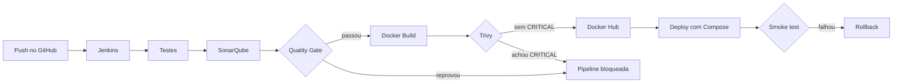

# Zeladoria SP

API para registrar e acompanhar problemas urbanos em São Paulo: buraco na rua, poste apagado, entulho na calçada, alagamento. O morador abre a ocorrência, os vizinhos confirmam, e o sistema calcula sozinho a prioridade e o prazo de atendimento.

O projeto foi feito para a Global Solution 2026 da FIAP (tema CitizenTech, disciplina de DevOps CI/CD). A aplicação é pequena de propósito. O trabalho de verdade está na esteira: todo push na `main` passa por testes, SonarQube, Trivy, publicação no Docker Hub, deploy e validação, sem ninguém apertar botão.

## Equipe

| Nome | RM | Turma |
|------|----|-------|
| Bruno Henrique Martins Ferreira | 566277 | 2TCNPZ |
| Ghhylherme Miguel | 562374 | 2TCNPZ |

## Como a esteira funciona



Os nove estágios estão no [Jenkinsfile](Jenkinsfile):

1. Checkout do código. A tag da imagem é montada aqui, com o número do build e o hash do commit (`14-a1b2c3d`).
2. Testes com pytest e lint com ruff, dentro de um container Python descartável.
3. Análise estática no SonarQube, que recebe também o relatório de cobertura.
4. Quality Gate. Se o Sonar reprovar, a pipeline para aqui.
5. Build da imagem Docker.
6. Trivy. Gera relatório em JSON e HTML e um SBOM em CycloneDX, que ficam guardados como artefatos do build. Uma vulnerabilidade CRITICAL com correção disponível derruba a pipeline.
7. Push da imagem para o Docker Hub, com a tag versionada e a `latest`.
8. Deploy com Docker Compose na mesma VM.
9. Validação funcional por HTTP. Se a versão nova não responder direito, o script de rollback devolve a versão anterior ao ar.

O Quality Gate do Sonar foi criado para este projeto. Além das regras padrão para código novo, ele exige do projeto inteiro pelo menos 80% de cobertura, nota A em confiabilidade e segurança e no máximo 5% de duplicação.

## O que a API faz

| Método | Rota | Para que serve |
|--------|------|----------------|
| GET | `/health` | Diz se a API e o banco estão de pé, e qual versão está rodando |
| GET | `/categorias` | Lista as categorias com SLA e peso |
| GET | `/subprefeituras` | Lista as 32 subprefeituras |
| POST | `/ocorrencias` | Abre uma ocorrência |
| GET | `/ocorrencias` | Lista, da mais urgente para a menos urgente. Aceita filtros por status, subprefeitura, categoria e atraso |
| GET | `/ocorrencias/{id}` | Detalha uma ocorrência |
| PATCH | `/ocorrencias/{id}/status` | Avança o status |
| POST | `/ocorrencias/{id}/apoios` | Um vizinho confirma o problema |
| GET | `/ocorrencias/metricas` | Totais por status e prioridade, atrasadas e percentual resolvido no prazo |

A documentação interativa fica em `/docs`.

### Regras de negócio

Cada categoria tem um peso e um prazo de atendimento (SLA):

| Categoria | SLA | Peso |
|-----------|-----|------|
| Alagamento | 6 h | 5 |
| Árvore com risco de queda | 12 h | 4 |
| Buraco na via | 72 h | 3 |
| Semáforo ou sinalização | 48 h | 3 |
| Iluminação pública | 48 h | 2 |
| Lixo e entulho | 24 h | 2 |
| Calçada danificada | 120 h | 1 |

A pontuação da ocorrência é o peso da categoria, mais 2 pontos se o problema fica perto de escola, hospital ou UBS, mais 1 ponto a cada 5 apoios de vizinhos (no máximo 3). De 4 pontos para cima a prioridade é média, de 6 é alta e de 8 é crítica. Ocorrência crítica tem o SLA cortado pela metade.

O status só anda por caminhos permitidos:

```
aberta -> em_analise -> em_execucao -> resolvida -> reaberta -> em_analise
aberta ou em_analise -> cancelada
```

Tentar pular etapa (por exemplo, de `aberta` direto para `resolvida`) devolve 409 com a lista dos próximos status aceitos.

Essas regras ficam em [app/regras.py](app/regras.py), em funções puras, e são a parte mais coberta pelos testes.

## Rodando na sua máquina

Com Docker:

```bash
docker build -t androww/zeladoria-sp:local .
IMAGE_REF=androww/zeladoria-sp:local docker compose up -d --wait
./scripts/smoke-test.sh http://localhost:8000
```

Sem Docker (usa SQLite):

```bash
python -m venv .venv && source .venv/bin/activate
pip install -r requirements-dev.txt
uvicorn app.main:app --reload
```

Testes:

```bash
pytest --cov
ruff check .
```

Um exemplo de uso:

```bash
curl -X POST http://localhost:8000/ocorrencias \
  -H 'Content-Type: application/json' \
  -d '{
        "categoria": "alagamento",
        "subprefeitura": "santana-tucuruvi",
        "endereco": "Av. Tucuruvi, 808",
        "descricao": "Rua alagada em frente à estação",
        "proximo_equipamento_sensivel": true
      }'
```

A resposta já traz `"prioridade": "alta"` e o `prazo_sla` calculado.

## Subindo a esteira numa VM

Usamos uma VM Ubuntu 24.04 na Azure (Standard_B2ms, 8 GB de RAM) com as portas 22, 8080, 9000 e 8000 liberadas. O SonarQube sozinho pede uns 3 GB, então máquina menor que 4 GB não aguenta.

```bash
git clone https://github.com/BrunoHenrique04/zeladoria-sp.git
cd zeladoria-sp
./infra/setup-vm.sh
```

O script instala o Docker, sobe o SonarQube, troca a senha padrão, gera o token de análise, cria o webhook e o Quality Gate, e por fim sobe o Jenkins já com as credenciais e o job da pipeline criados (via Configuration as Code). Ele pergunta só o usuário e o access token do Docker Hub. As senhas são geradas na hora e ficam em `infra/.env`, que não vai para o Git.

Depois disso falta cadastrar o webhook no GitHub, apontando para `http://IP_DA_VM:8080/github-webhook/`. O próprio script mostra os valores no final.

## Estrutura

```
app/                  código da API (FastAPI + SQLAlchemy)
  regras.py           prioridade, SLA e transições de status
  routes/             endpoints de ocorrências
tests/                testes de regra e de API
scripts/              deploy, rollback e smoke test
infra/                Jenkins, SonarQube e o script de preparo da VM
docs/                 roteiro de troubleshooting
Dockerfile            imagem da aplicação (multi-stage, usuário sem root)
docker-compose.yml    aplicação + PostgreSQL
Jenkinsfile           a pipeline
```

## Troubleshooting

O roteiro da falha controlada (quebrar, ver a pipeline bloquear, investigar, corrigir e passar de novo) está em [docs/troubleshooting.md](docs/troubleshooting.md).

## Créditos e licença

A ideia e o domínio vêm do [CivicLens](https://github.com/tejasbhor/Civiclens), plataforma open source de gestão de ocorrências urbanas publicada sob licença MIT. Seguindo o que o enunciado permite, ficamos só com um backend FastAPI e reescrevemos o código para o contexto de São Paulo, com regras próprias de prioridade e SLA.

Este repositório também usa a licença MIT. Veja [LICENSE](LICENSE).
